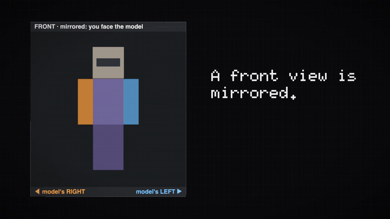
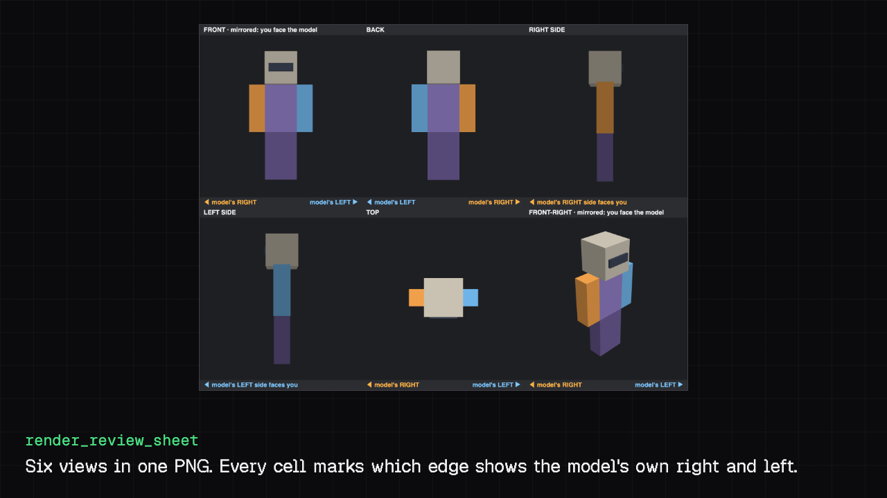
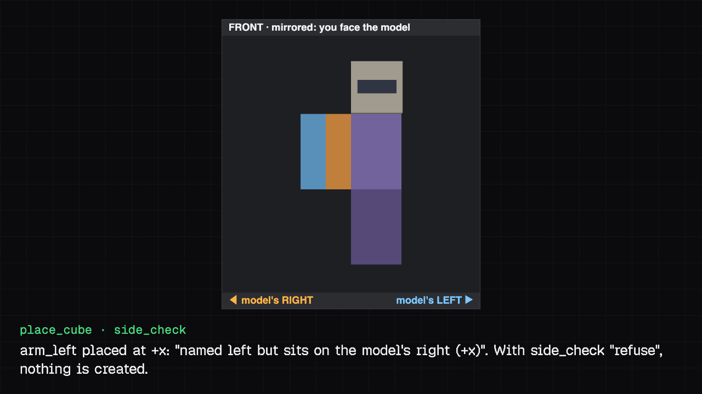
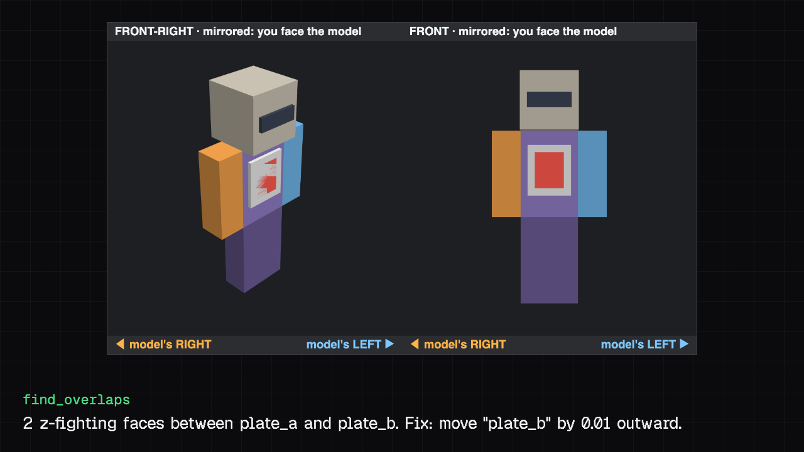
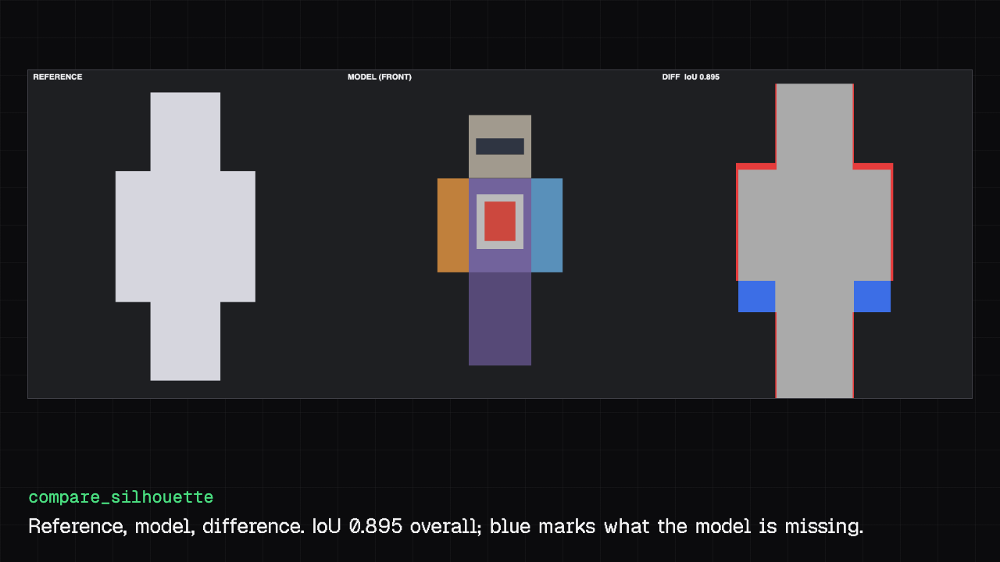
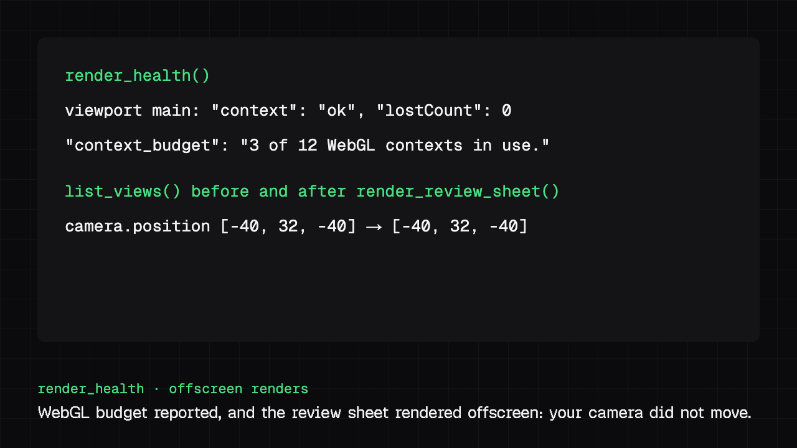

<!-- Modified by AIKUSAN, 2026-11-06: rewritten for Blockwright MCP; the upstream README is kept in docs/upstream-README.md. -->
<!-- Modified by AIKUSAN, 2026-11-07: sections reordered; the full tool list moved to docs/tools.md. -->
<!-- Modified by AIKUSAN, 2026-11-07: "See it work" filled with images from the launch session; the tool count is left out until it is re-checked; the launch demo is shown as a GIF. -->
<!-- Modified by AIKUSAN, 2026-11-10: "Skills and agents" section added, and the sosadly tools updated to 0.4.0 (76 registered). -->
# Blockwright MCP for Blockbench

An unofficial MCP server that runs inside Blockbench, so AI assistants such as Claude Code and Claude Desktop can work on your models with you.

[](LICENSE)
[](https://github.com/AIKUSAN/blockwright-mcp/releases)
[-1e93d9)](https://www.blockbench.net/)

> Blockwright MCP is not an official Blockbench product and is not endorsed by the Blockbench project, by Jason J. Gardner, or by sosadly.

## What it does

Blockwright MCP is a Blockbench plugin. Once it is loaded, Blockbench serves the Model Context Protocol at `http://localhost:3001/blockwright`, and an MCP client can use its tools on the open project, from placing the first cube to exporting the finished model. Screenshots render offscreen, so your camera stays where you left it.

It combines [blockbench-mcp-plugin](https://github.com/jasonjgardner/blockbench-mcp-plugin) by Jason J. Gardner (the base) with the tools of [blockbench-mcp](https://github.com/sosadly/blockbench-mcp) by sosadly, plus additions for day-to-day modelling work.

## Features

- **Review sheets:** front, back, sides, top and a three-quarter view in one PNG, each cell marking where the model's own right and left are.
- **Side guard:** `place_cube` and `add_group` warn, or refuse, when a part named left sits on the model's right.
- **Overlap and z-fighting finder:** `find_overlaps` lists flickering coplanar faces and intersecting cubes, rotated ones included, with a suggested fix.
- **Silhouette compare:** `compare_silhouette` scores the model's outline against a reference image.
- **WebGL safety:** lost views are rebuilt automatically, blank frames are refused, and new views stop before Chromium's context limit.
- **Offscreen rendering:** review and screenshot tools never move your camera.

## See it work



All images below are real tool output from Blockbench 5.2.2 on a scratch test model.











## Requirements

- Blockbench desktop 5.0 or newer (tested on 5.2.2). The web version cannot run the server.
- An MCP client: Claude Code, Claude Desktop, or any client that speaks MCP over HTTP.
- Node.js, for Claude Desktop only (it connects through `npx mcp-remote`).
- Bun, only to build from source.

## Install

### 1. Blockbench

1. Download `blockwright_mcp.js` from the [latest release](https://github.com/AIKUSAN/blockwright-mcp/releases/latest), or `plugin/blockwright_mcp.js` from this repository.
2. In Blockbench: **File > Plugins > Load Plugin from File**, then choose the file.
3. Blockbench asks for permission to use network and system modules; the MCP server needs them. Allow them. File access is asked for the first time a tool reads a file (for example a reference image for `compare_silhouette`).
4. The server listens on `http://localhost:3001/blockwright`. Port and path can be changed under **Settings > General**.

The text of the MCP prompts is built into the plugin. Only a build without it fetches the text from this repository through the jsDelivr CDN (`cdn.jsdelivr.net/gh/AIKUSAN/blockwright-mcp`); **Settings > General** can turn that off. Nothing about your models is sent.

### 2. Claude Code

```
claude mcp add --transport http blockwright http://localhost:3001/blockwright
```

### 3. Claude Desktop and other MCP clients

Claude Desktop: add this to `claude_desktop_config.json` and restart the app:

```json
{
  "mcpServers": {
    "blockwright": {
      "command": "npx",
      "args": ["-y", "mcp-remote", "http://localhost:3001/blockwright"]
    }
  }
}
```

Other clients: point them at `http://localhost:3001/blockwright` (streamable HTTP). If a client only starts local commands, use the same `npx -y mcp-remote http://localhost:3001/blockwright` bridge.

## Quick start

1. Open or create a project in Blockbench. Most tools appear only while a project is open.
2. Ask your assistant, for example:
   - "Add a body and two arms, then render a review sheet."
   - "Find z-fighting in this model and fix it."
   - "Compare the front view with `~/Downloads/reference.png`."
3. Check the result in Blockbench. Most changes go into its undo history, so Ctrl+Z (Cmd+Z on macOS) takes them back.

## Tool reference

| Category | Tools | Examples |
|---|---:|---|
| Cubes | 5 | `place_cube`, `modify_cube`, `knife_cut_cube` |
| Camera & Screenshots | 7 | `capture_screenshot`, `capture_app_screenshot`, `set_camera_angle` |
| Review & Renderer Health | 3 | `render_review_sheet`, `render_health`, `recover_renderer` |
| Ported from sosadly/blockbench-mcp (MIT) | 76 | `get_status`, `get_guide`, `inspect_model` |
| Quality checks | 2 | `find_overlaps`, `compare_silhouette` |
| Capabilities | 1 | `get_capabilities` |
| Animation | 9 | `create_animation`, `manage_keyframes`, `animation_graph_editor` |
| Armature | 17 | `list_armatures`, `get_armature`, `add_armature` |
| Display Settings | 3 | `get_display_transform`, `set_display_transform`, `enter_display_mode` |
| Elements | 9 | `remove_element`, `add_group`, `list_outline` |
| Export | 2 | `list_export_formats`, `export_model` |
| History | 4 | `undo`, `redo`, `get_undo_stack` |
| Import/Export | 1 | `from_geo_json` |
| Material Instances | 5 | `get_face_material_instances`, `set_face_material_instance`, `list_material_instances` |
| Mesh Editing | 15 | `place_mesh`, `extrude_mesh`, `subdivide_mesh` |
| Paint Tools | 12 | `paint_fill_tool`, `draw_shape_tool`, `gradient_tool` |
| Particles | 7 | `list_particle_presets`, `create_particle_effect`, `update_particle_effect` |
| Performance | 1 | `get_average_fps` |
| Project | 2 | `create_project`, `get_project_info` |
| Textures | 14 | `create_texture`, `apply_texture`, `add_texture_group` |
| UI Interaction | 6 | `trigger_action`, `risky_eval`, `emulate_clicks` |
| UV Mapping | 5 | `set_mesh_uv`, `auto_uv_mesh`, `rotate_mesh_uv` |
| GeckoLib Integration | 10 | `geckolib_get_format_info`, `geckolib_set_project_settings`, `geckolib_list_easings` |
| Hytale Integration | 12 | `hytale_get_format_info`, `hytale_validate_model`, `hytale_set_cube_properties` |

The full list of tools is in [docs/tools.md](docs/tools.md).

## Skills and agents

Blockwright bundles the Agent Skills of both upstream projects, so an assistant knows how to model, texture, rig and animate with these tools, not only which tools exist. The files are unchanged. Each folder says where it came from (`UPSTREAM.md`) and carries its licence (`LICENSE.upstream`).

| What | Where | Source |
|---|---|---|
| 15 skills: `blockbench-use` (load it first), `-modeling`, `-texturing`, `-pbr-materials`, `-animation`, `-particles`, `-hytale`, `-vanilla-textures`, `-mcp-overview`, `-new-model`, `-development`, `-albedo-to-pbr`, `-gpt-image-textures`, `-flipbook-textures`, `-substance` | `skills/` | [blockbench-mcp-project](https://github.com/jasonjgardner/blockbench-mcp-project), Apache-2.0 |
| `blockbench-mcp-modeling`: build from references, with cube budgets and review passes | `skills/` | [sosadly/blockbench-mcp](https://github.com/sosadly/blockbench-mcp), MIT |
| `blockbench-physical-accuracy-reviewer`, a read-only agent that checks that a model of a real object could exist and work | `agents/` | blockbench-mcp-project, Apache-2.0 |

To install the skills for Claude Code, from a checkout of this repository:

```bash
bin/install-skills.sh            # copies every skill into ~/.claude/skills; skips and names any that already exist
bin/install-skills.sh --update   # replaces the ones that exist; the old copy moves to ~/.claude/skills/_old/<name>_<date>/
```

Nothing is deleted. For another client that reads Agent Skills, copy the folders from `skills/` into that client's skills folder. To use the agent in Claude Code, copy it into place: `mkdir -p ~/.claude/agents && cp agents/*.md ~/.claude/agents/`. The file is unchanged upstream text: it sets `model: opus` and allows web search and fetch, so edit your copy if you want otherwise.

Some skills need more than Blockbench. `blockbench-gpt-image-textures` needs a fal.ai key for a paid online service, `blockbench-new-model` needs Blender and FFmpeg, and `blockbench-substance` needs a licensed Substance 3D install. The skills only describe those steps, and Blockwright adds no tool for them.

## What's different from upstream

- **One plugin, one tool set.** The base plugin's tools plus 76 tools from sosadly/blockbench-mcp 0.4.0, with no separate bridge process. `find_references`, sosadly's web image search, is left out: Blockwright adds no tool that needs an online service.
- **Review sheets.** `render_review_sheet` renders front, back, sides, top and a three-quarter view into one PNG. Each cell marks where the model's own right and left are, because a front view is mirrored.
- **Left/right checks.** `which_side` and `check_sides` compare names such as `arm_left` with the geometry. A Minecraft-style model faces −Z, so its own right is +X in Blockbench. Note that the Bedrock export mirrors X: the model's right is −X in a `.geo.json`.
- **WebGL recovery.** Screenshots refuse frames from a lost WebGL context instead of returning blank images. `render_health` and `recover_renderer` rebuild what can be rebuilt and say when Blockbench must be restarted.
- **The user's camera stays put.** All review and screenshot tools render offscreen.
- **Side guard.** `place_cube` and `add_group` compare left/right names with where the part sits, and warn (or, with `side_check: "refuse"`, create nothing) when they disagree.
- **Overlap and z-fighting finder.** `find_overlaps` uses each cube's real world transform, so rotated cubes and rotated groups count. It lists coplanar faces that flicker and cubes that intersect, with a suggested outward offset for each z-fighting pair.
- **Silhouette compare.** `compare_silhouette` renders one view offscreen and compares its outline with a reference image. You get one image (reference, model, difference) plus an overlap score overall and per region.
- **WebGL budget guard.** New offscreen views are refused before Blockbench gets close to Chromium's limit on live WebGL contexts. A lost offscreen view is rebuilt automatically on its next render, and every loss shows a notice inside Blockbench.
- **Runs beside the original.** Its own plugin id, port, settings and panels.

The full list is in [CHANGELOG.md](CHANGELOG.md).

## Troubleshooting

- **Screenshots are black or blank, or a "WebGL was lost" notice appears.** Run `render_health`, then `recover_renderer`. Lost offscreen views are rebuilt on their next render. If the notice names the main viewport, save your project and restart Blockbench. `create_offscreen_view` refuses new views at 12 live WebGL contexts; delete views you no longer need with `delete_offscreen_view`.
- **A file cannot be read.** On macOS, Blockbench may only be able to read files in `~/Downloads`. Put reference images and models there, or give Blockbench access to the folder in **System Settings > Privacy & Security**.
- **The client cannot connect.** Check that Blockbench is open and the plugin is loaded. If port 3001 is taken, change the port under **Settings > General** and update the URL in your client. Blockwright MCP uses its own port and path, so it can run beside the original plugin on port 3000.
- **The plugin does not start after a permission prompt.** Blockbench asks once for each kind of access. Choose **Always allow for this plugin**; if you denied it, reload the plugin from **File > Plugins**.

## Contributing and issues

Please report problems with Blockwright MCP in this repository's [issue tracker](https://github.com/AIKUSAN/blockwright-mcp/issues), not to the upstream projects. Pull requests are welcome.

Build from source:

```
bun install
bun run build        # writes dist/blockwright_mcp.js
bun test             # upstream and Blockwright tests
node --test tests-node/
```

`build/port-sosadly.py <checkout of sosadly/blockbench-mcp>` regenerates the ported sosadly files.

## Credits

- Base: [blockbench-mcp-plugin](https://github.com/jasonjgardner/blockbench-mcp-plugin) by Jason J. Gardner and contributors, GPL-3.0-only.
- Ported tools and the Copilot panel: [blockbench-mcp](https://github.com/sosadly/blockbench-mcp) by sosadly, MIT. The MIT notice is kept in the ported files and in `LICENSES/`.
- Changes and additions: Copyright (c) 2026 AIKUSAN (Minecraft IGN: AIKUSAN).

The upstream README is kept in [docs/upstream-README.md](docs/upstream-README.md).

## License

Blockwright MCP as a whole is licensed under the GNU General Public License v3.0 only. See [LICENSE](LICENSE) and [NOTICE](NOTICE).
